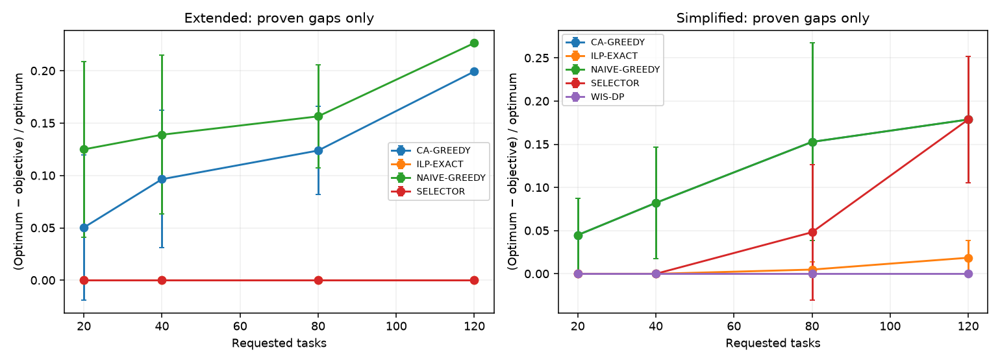
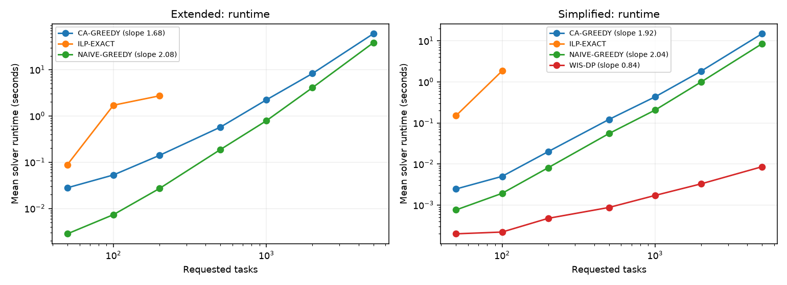
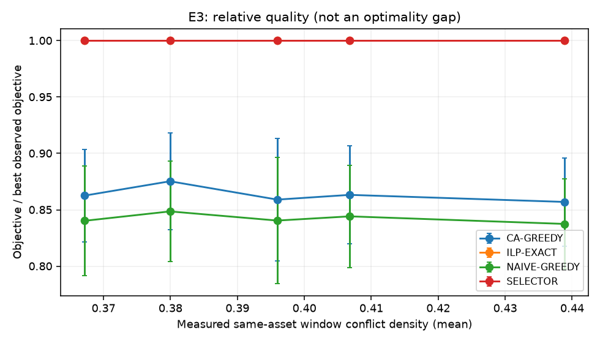
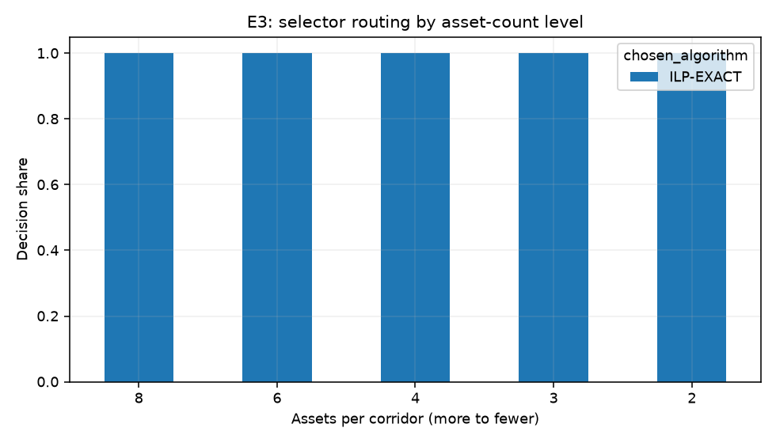

# Phase 9: measured scheduling experiments

All solver calls ran serially. Runtime excludes generation, validation and I/O. Tables report sample standard deviations (ddof=1); single observations have no estimated standard deviation. Missing/failed/censored-without-incumbent values are not treated as zero. Error bars show one standard deviation, not confidence intervals.

## Completeness and correctness

| Study | Rows | Errors | Violations | Anomalies | ILP OPTIMAL / attempted | Timeouts (including selector) | Skipped ILP | Rows with proven gaps |
|---|---:|---:|---:|---:|---:|---:|---:|---:|
| E1 | 1080 | 0 | 0 | 0 | 153 / 240 | 117 | 0 | 960 |
| E2 | 245 | 0 | 0 | 0 | 11 / 21 | 10 | 49 | 133 |
| E3 | 600 | 0 | 0 | 0 | 56 / 150 | 188 | 0 | 224 |

Exact gaps use only same-instance ILP OPTIMAL or simplified WIS-DP references. A FEASIBLE incumbent is never an optimum. When a reference is unproven the gap is missing, even if the incumbent happens to be best. Relative quality is objective divided by the best observed valid objective for the same instance; it is not a gap.

CP-SAT uses one worker, random seed 0, a 30-second wall cap and one unit of deterministic search. E2 stops ILP for each seed/kind after an unproven result. These are budget-specific results, not claims about unrestricted solver performance. CA-GREEDY uses a five-task lookahead.

## E1: solution quality

Every point and its sample size is in [summary_E1.csv](summary_E1.csv): `gap_count` counts proven gaps; `n_total` is the full cell size. Extended and simplified instances are analyzed separately.

## Paired CA-minus-naive differences

| Study | Pairs | CA wins | Ties | CA losses |
|---|---:|---:|---:|---:|
| [E1](paired_E1.csv) | 240 | 85 | 142 | 13 |
| [E2](paired_E2.csv) | 70 | 16 | 42 | 12 |
| [E3](paired_E3.csv) | 150 | 100 | 39 | 11 |

The linked paired tables give mean and sample standard deviation of the within-instance difference for each size/knob/kind. Losses are retained.

## E2: scalability

[summary_E2.csv](summary_E2.csv) provides `runtime_s_count` behind every point. [runtime_slopes.csv](runtime_slopes.csv) fits log(mean runtime) against log(n); ILP slopes use only OPTIMAL observations and are omitted when fewer than two sizes remain. The plotted ILP incumbent times may be budget-censored.

The measured simplified WIS-DP slope is **0.841**. This is a finite-range timing observation; it does not prove asymptotic complexity. The implementation's expected bound is O(n log n).

## E3: asset-count / conflict study

[summary_E3.csv](summary_E3.csv) contains objective-ratio counts, actual measured density, true-gap counts and means. [selector_shares_E3.csv](selector_shares_E3.csv) contains every decision count and denominator. Assets per corridor are 8, 6, 4, 3, 2; the x-coordinate in the ratio figure is measured conflict density, not an assumed monotonic density. Changing asset count also changes generated task assignments and priorities, so this is a controlled generator-knob study, not isolated causal evidence.

## Reproducibility and seed-half consistency

- E1: complete repeat, 1080/1080 rows compared; objectives, instance hashes, statuses, chosen algorithms, coverage and schedule counts identical.
- E2: PARTIAL repeat, 99/245 rows compared; objectives, instance hashes, statuses, chosen algorithms, coverage and schedule counts identical.
- E3: not repeated; no reproducibility claim for this study.

**Verification scope:** The user requested a shorter verification run. Remaining repeat runs were stopped; primary E1/E2/E3 grids are complete. Partial repeat agreement is not evidence of a full-study repeat.

Seed halves split the sorted seeds at the midpoint (15/15 for E1 and E3, 2/3 for E2). [E1 halves](seed_halves_E1.csv), [E2 halves](seed_halves_E2.csv), and [E3 halves](seed_halves_E3.csv) retain counts, means and standard deviations. The table below compares CA-minus-naive mean objective differences in the two halves by cell; sign agreement is descriptive, not a significance test.

| Study | Comparable cells | Same sign | Largest absolute half difference |
|---|---:|---:|---:|
| E1 | 8 | 8 | 21.000 |
| E2 | 14 | 11 | 98.833 |
| E3 | 5 | 5 | 20.200 |

## Provenance and limitations

[phase9_audit.json](phase9_audit.json) records source/config fingerprints, commit identifiers, dependency versions, objective hashes and completion checks. Full resolved configs, per-run schedules and UTC timestamps are in ignored raw results. Commands and resumption semantics are in [EXPERIMENTS.md](../docs/EXPERIMENTS.md).

These synthetic results do not establish operational railway performance. Requested size and actual generated count are both retained because generation may drop individually infeasible tasks. Timing reflects this machine and these workloads; large-size heuristic curves need not expose their worst-case behavior. A selector that always chooses one solver on a study has not demonstrated adaptive benefit there. The E2 seed count is small and its halves are unequal.
